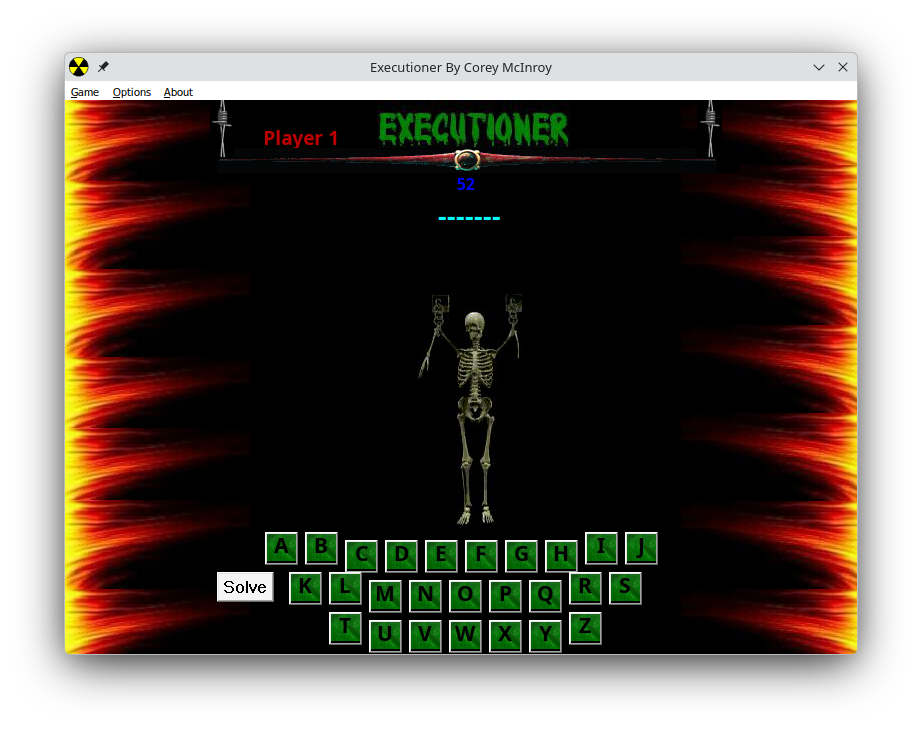

# Executioner

**Executioner** is a classic Hangman-style game originally created in 1999 using Visual Basic 6.

---

## 🧾 Introduction

Through your journey, your faithful companion has been captured by the Executioner. After battling your way through the dungeon, you finally reach his lair—only to be captured yourself.

With a grin and the stench of death lingering in the air, the Executioner speaks:

> “You are a worthy adventurer to have made it this far.”

He pauses, scratches his head, and begins to leave—then hesitates.

> “I myself have honor. Therefore, I will give you one last chance.”

Leaning closer, he whispers:

> “Answer my phrase and I shall let you and your companion go free. If you fail, you both shall die a horrible death!”

---

## 🎮 Playing the Game

- All options are available via the **menu bar** in the top-left corner.
- To start a game:
  - Click **Game → 1 Player** or **2 Players**
  - A checkmark indicates the selected mode
- To configure gameplay:
  - Click **Options → Advanced Options**
  - Adjust time limits and number of hints

---



#### 🔊 Sound Warning

Visual Basic 6 timers are tied to the **system clock rather than true real-time**, which can lead to timing drift, delayed playback,
or desynchronization of sound effects depending on system.

---

## 🕹️ Game Controls

- Use your **mouse** to select letters.
  - Correct letters appear in the phrase
  - Incorrect guesses harm your companion 😬

- Click **Hint** to reveal a letter:
  - Limited uses (configurable in Advanced Options)

- Click **Solve** to guess the full phrase:
  - Type your answer (case-insensitive) and press **Enter**
  - If nothing happens, the guess is incorrect

---

## 🔁 Restarting

After each game:

- Press **F1** to start a new game  
**OR**
- Use the **menu bar**  
**OR**
- Click the **animated skeleton** in the main window

---

## 💾 Installation

1. Run the [Installer](https://github.com/creptic/executioner/releases/download/v1.0/Executioner.msi) program
2. Follow the on-screen instructions
3. Launch the game after installation completes

---

## 💻 System Requirements

- Windows 95/98 or newer
- Resolution: **800×600** Only
- Color: **16 colors** minimum
- Mouse & Keyboard
- ~2 MB of hard drive space
- Sound card
- Sense of humor (strongly recommended)

---

## 📝 Notes & Comments

- Originally created as a **school project**
- Sound effects were sourced from existing games and personal files

You can customize phrases by editing:

```
/Data/phrases.txt
```

---

## 🔄 Updates (12/12/2009)

- Tested on Windows 7
- Revamped idle screen
- Added option to disable sound
- Minor bug fixes
- Updated timers for modern systems

---

## ⚖️ License / Usage

This project is shared for preservation and educational purposes.  
Feel free to modify, expand, or modernize it.

---

# ☕ Support / Donate 
If you enjoy **Executioner**, consider buying me a coffee

[](https://www.paypal.com/paypalme/crepticdev)

---

Enjoy the game… and good luck escaping the Executioner.
